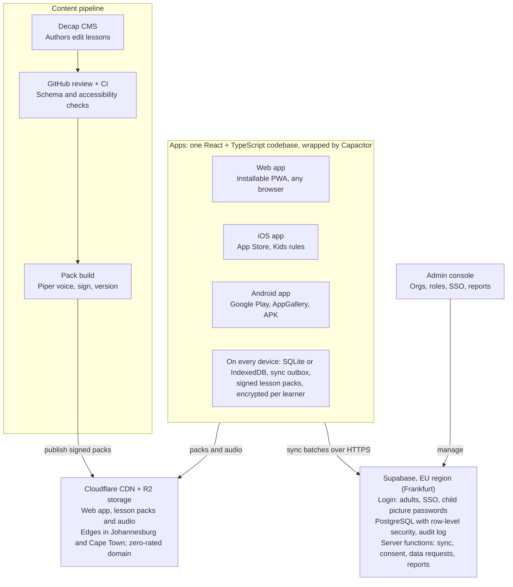

# 2to.iQ Thinking Lab: System Design

Last updated: 2 November 2026

## 1. Executive summary

Thinking Lab becomes one codebase that ships as a web app, an iOS app and an Android app. It works fully offline, serves several curricula (starting with CAPS and D-CAPS), and complies with POPIA and EU law, for well under R5,000 a year in fixed costs until it has paying customers.

**The key decisions:**

1. **One codebase, three platforms.** React + TypeScript, wrapped with Capacitor for the App Store and Google Play. The current accessibility work and games carry over instead of being rewritten.
2. **Offline-first.** Everything a learner does is saved on the device first and synced when there is signal. Learners can stay offline for 30 days.
3. **Curriculum-neutral content.** Lessons map to learning outcomes, not grades. One lesson can serve CAPS Grade 3, D-CAPS Level 2 and a European framework at the same time, and a learner's age is kept separate from their learning level.
4. **One legal baseline for both markets.** Learner data is hosted in the EU (Frankfurt), which meets GDPR directly and counts as adequate protection for POPIA's cross-border rules. The strictest rule from either law applies everywhere.
5. **Near-zero budget.** Use open-source tools and free tiers throughout, add a backend only when real learners need accounts, and treat app store fees as the main unavoidable cost.
6. **Inclusion as the core product.** Greyscale mode joins the existing supports, and every game must work without colour.
7. **Child safety designed in.** The app has a disclosure protocol, helplines and ethical design rules from the first release, not after launch.

The biggest risks are legal: handling disability data about children, which is special-category data under both GDPR and POPIA, and using non-EU staff to access EU data. Both are planned for in sections 12 and 20.

## 2. Context, goals and constraints

The product is proven as a prototype: 180 lessons, 8 thinking games, 4 skills tracks and a strong accessibility layer. It now needs to become a real, sellable, multi-market product without a budget.

### Goals

| # | Goal | Measure of success |
| --- | --- | --- |
| G1 | Available on the App Store, Google Play and the web | Approved listings on all three; one codebase |
| G2 | Works online and offline | Every learner feature works in airplane mode; sync after 30 days offline loses nothing |
| G3 | Serves many curricula | CAPS, D-CAPS, NCF and GETCA mapped at launch; a new curriculum added without code changes |
| G4 | Inclusive by default | WCAG 2.2 AA, plus greyscale, calm and switch-access modes; every game playable without colour |
| G5 | Lawful in South Africa and the EU | POPIA and GDPR compliance signed off before real learner data is collected |
| G6 | Enterprise-ready | Many organisations in one system, roles, single sign-on, audit logs, reports |
| G7 | Affordable to run | Fixed costs under R5,000 a year until revenue; costs grow with paying customers, not users |

### Constraints

- **Little to no budget.** Free tiers, open-source tools and volunteer or grant-funded time. Every paid item must have a trigger that justifies it (section 16).
- **Two legal regimes.** POPIA (South Africa) and GDPR plus other EU law. Where they differ, the stricter rule applies everywhere.
- **Low-end devices.** Android 8+ phones with 2 GB of RAM, shared family or school devices, and some Huawei phones without Google Play.
- **Poor connectivity and power.** Prepaid data, patchy signal and load-shedding, so short sessions, offline use and low battery drain matter.
- **Very vulnerable users.** Children aged 3 and up, including learners with severe intellectual disability. Safety beats engagement in every trade-off.

### Scale targets for planning

- 1 million registered learners, 100,000 using it at the same time at peak (school mornings)
- 30 days offline without data loss
- App install under 30 MB, with lesson packs downloaded separately
- A typical lesson session uses under 100 KB of data once its pack is downloaded

### What the prototype already does (keep all of it)

- Learner flows: assent screen, feelings and needs check-in, battery check-in, breaks with breathing and movement, goodbye
- Thinking Lab games: Pattern, Vetkoek, Comic, Memory, Paint Pots, Robot Rescue, Colour and Shape Sort, Kraal
- 180 lessons from early years to adult learning, with worked examples, hints, reflection, word help and voice clips
- Skills tracks: Cooking, Coding, Money and small business, Sport, with 9 more planned
- Supports: My way, my plan, talk board, switch scanning, reading ruler, word highlighting, Support Passport, Tell us
- Display: light and dark themes, high contrast, reduced motion, dyslexia-friendly fonts, text size
- Adult views: demo dashboard, strengths, session summary, curriculum links
- Avatar builder, badges, themed maths word problems

### Not in scope

- Ads, in-app purchases aimed at children, or selling data, ever
- Social features between children (chat, public profiles, leaderboards)
- AI that infers a child's emotions, ability or diagnosis
- Replacing teachers, therapists or formal assessment and placement processes

## 3. Users and roles

The platform has three kinds of user, and they need very different things. Learners need a calm, simple, offline experience. The adults around them need insight and control. Organisations need administration, reporting and compliance.

### Learners

| Group | Typical needs | Design implications |
| --- | --- | --- |
| Early years (3–6) | Pictures, voice, short turns, adult nearby | Read-aloud on by default, no reading needed, adult-assisted login |
| School age (7–18), mainstream (CAPS or other curricula) | Curriculum practice, motivation, privacy from peers | Grade-aligned lessons, badges without public rankings |
| Learners with disabilities (D-CAPS, special schools, full-service schools) | Functional skills, routine, communication support, sensory regulation | Level set apart from age, talk board, greyscale and calm modes, switch access, observation-based progress |
| Young adults (19–25) | Life and work skills, adult tone, own data | GETCA lessons, respectful wording, self-managed account from 18 |
| Learners in EU countries | Local curriculum and language, GDPR rights | Curriculum packs per country, translated UI, EU consent ages |

### Adults

| Role | Main jobs | Sees |
| --- | --- | --- |
| Parent or guardian | Give consent, support at home, view progress | Their own children only |
| Teacher or facilitator | Assign lessons, observe, adapt support | Their groups only |
| Special-needs educator, therapist (OT, speech) | Set up support profiles, record observations against an Individual Support Plan | Learners they are assigned to, including support needs |
| Care worker (stimulation and care centres) | Run sessions on shared devices, often with low digital confidence | Their centre's learners, simplified view |
| School or site admin | Manage staff, learners and devices | Their site |
| Organisation admin (district, NGO, employer, network of schools) | Contracts, single sign-on, reports, data requests | Their organisation, mostly in aggregate |
| Content author and reviewer | Write, translate, review and approve lessons | Content tools only, no learner data |
| Information Officer / Data Protection Officer | Handle data requests, breaches, audits | Audit logs and request queue |
| Platform support and operations | Run the system, fix problems | Only what a support ticket needs, every access logged |

### Principles for every role

- **Least access.** Each role sees the minimum it needs. Learner-level detail is visible only to adults with a direct relationship to that learner.
- **Children are never contactable.** No messaging to or between children, and no child contact details stored.
- **Older learners own their data.** At 18 (or the local age of digital consent for GDPR purposes, where consent is the legal basis), learners can see, export and control their own records.

## 4. Curriculum model: D-CAPS and beyond

Lessons should belong to **learning outcomes**, not to grades. Each curriculum is a set of outcomes, and one lesson can map to outcomes in several curricula at once. That's what lets D-CAPS, CAPS and EU curricula share one content library.

### What D-CAPS is

- **Differentiated Curriculum and Assessment Policy Statement**: South Africa's curriculum for special schools and learners with significant barriers to learning, especially severe intellectual disability (SID) ([Unity College](https://unity-college.org.za/what-is-dcaps-special-needs-curriculum/)).
- It covers national CAPS content "at a reduced depth and width, or at a more functional level" ([Rens & Louw, 2021](https://scielo.org.za/scielo.php?script=sci_arttext&pid=S2221-40702021000200008)).
- It arose from the 2010 court case *Western Cape Forum for Intellectual Disability v Government of the RSA*. The Minister approved the adjusted Life Skills curriculum in 2013, and it was piloted in schools from 2018 (Rens & Louw).
- The DBE has published a draft CAPS for **Grades R–5 for learners with SID**, with subjects including Life Skills, Physical Education, Creative Arts, Mathematics, English Home Language and First Additional Language, Natural Sciences, and vocational subjects such as Food Production, Office Administration and Ancillary Health Care ([DBE call for comments](<https://www.education.gov.za/Resources/Legislation/CallforComments/CallforcommentsonthedraftcurriculumandassessmentpolicystatementGradeR-5forlearnerswithSevereIntellectualDisability(SID).aspx>)).
- Assessment follows each learner's level "as set out in the individual support plan" (ISP), under the 2014 **SIAS** policy (Screening, Identification, Assessment and Support). Rubrics are commonly used (Rens & Louw).

**Open question:** the final status of the Grades R–5 SID CAPS and its exact outcome codes are not confirmed. A curriculum specialist must obtain the official DBE documents before D-CAPS content is mapped.

### What D-CAPS means for the design

1. **Age and learning level are separate.** A 14-year-old may work at Foundation Phase level in mathematics and higher in Life Skills. Each learner has an age band (for tone, safety and consent) and a level *per subject* (for content).
2. **Functional skills are first-class content.** Personal care, money, communication, safety and occupational tasks need their own outcome types, not just academic ones. The existing skills tracks (cooking, money) are a strong start.
3. **Progress is shown through support levels, not marks.** The prototype's "shown without support / with support / not yet" model fits D-CAPS directly.
4. **Teachers need ISP goals in the app.** They should be able to link lessons and observations to a learner's individual support goals.
5. **Vocational pathways.** D-CAPS links to occupational subjects, and the 19–25 track links to GETCA and TVET, so the content model must cover routes into work.

### Curricula supported

| Curriculum | Who it serves | Priority |
| --- | --- | --- |
| CAPS (Grades R–12) | South African mainstream schools | Launch (already mapped as "proposed") |
| D-CAPS and SID CAPS | Special schools, learners with SID | Launch (needs specialist mapping) |
| NCF Birth to Four | Early childhood centres | Launch (already mapped) |
| GETCA (NQF level 1) | Adult learners | Launch (already mapped) |
| Learning Programme for Severe to Profound Intellectual Disability | Special care centres | Phase 3 |
| EU national curricula (e.g. Ireland, Netherlands, Germany) and the EU Key Competences framework | European customers | When the first EU customer signs |
| Cambridge Primary, IB PYP | International and private schools | On demand |
| Organisation-specific frameworks | Employers, NGOs | On demand, through custom packs |

### Data model for curricula

```
Framework (e.g. CAPS 2011, D-CAPS SID, NCF 2015, GETCA)
 └── Stage (phase, key stage, level band)
      └── Level (grade, year, D-CAPS level)
           └── Subject or learning area
                └── Topic or strand
                     └── Outcome (code, description, version)

Lesson ── maps to ── many Outcomes (in many frameworks)
Learner ── follows ── one or more Frameworks, with a Level per Subject
```

- **Versioned frameworks.** Curricula change, as CAPS has been revised. Old mappings are kept so past reports stay accurate.
- **Confidence on each mapping.** Mappings are marked *proposed* (as in today's app), *specialist reviewed* or *officially endorsed*, and only reviewed mappings appear in official reports.
- **Mappings live in data, not code.** Adding a curriculum means importing its outcomes and mapping lessons in the content tool, with no app release.

## 5. Learning, assessment and content model

Every lesson, game and skill project becomes structured data checked against one schema. The app reads it to draw screens, and teachers' reports are built from it. No lesson is written as HTML inside code, as it is today.

### Content types

| Type | What it is | Example today |
| --- | --- | --- |
| Lesson | Goal, lesson pages, worked example, practice questions with hints, reflection, word help | "m4-place" (place value) |
| Thinking activity | A game with rules, levels and observed behaviours | Pattern, Robot Rescue |
| Skill project | A hands-on task with needs, safety notes, steps and a badge | Cooking projects |
| Functional routine (new) | A step-by-step daily-living task with picture prompts, for D-CAPS | Washing hands, paying at a shop |
| Passage | A story, poem, article or document used by lessons | "Lulu's Lost Hat" |
| Media | Voice clips, images, symbols, sign language video | Piper voice clips |

### Lesson schema (fields)

- **Identity:** ID, version, languages available, status (draft, in review, approved, retired)
- **Targeting:** outcome mappings (section 4), difficulty level, age-appropriateness band, estimated minutes
- **Content:** pages, example, questions (multiple choice, ordering, build, drawing, open), hints (up to 3), explanations, reflection, word help, plain-language version, easy-read version
- **Accessibility:** text alternatives for every image, a version that works without colour, read-aloud lines, sign language video link, symbol (AAC) version
- **Localisation:** contexts that can be swapped (currency, names, foods, places), as the themed maths problems already do
- **Safeguarding flag:** marks lessons on sensitive topics (body safety, bullying, conflict) so the safeguarding rules in section 13 apply

### How progress is recorded

The prototype's observation model becomes the standard for all learners:

| Record | Captured | Used for |
| --- | --- | --- |
| Attempt | Each question: answer, hints used, checks, time, how the learner answered (tap, build, draw, adult tapped) | Teacher detail view |
| Observation | Per skill: shown without support, with support, not yet shown, idea shared | Strengths, ISP progress |
| Reflection | What the learner said helped | Learner voice in reports |
| Wellbeing check-in | Feelings, needs, battery level (self-reported only) | Adjusting the session; never stored by default |
| Badge | Skill projects finished | Motivation; visible only to the learner and their adults |

**Mastery** of an outcome is reached after it is shown without support in two separate sessions. This is a starting rule for specialists to confirm.

### Individual Support Plans

- A teacher or therapist can record ISP goals (aligned with SIAS) on a learner's profile and link them to outcomes.
- Observations count towards those goals automatically, and the teacher sees progress per goal.
- The **Support Passport** (what helps me, what's hard, how I communicate) travels with the learner between teachers and schools, with consent.

### What the system never does

- Rank children against each other or show scores to other children
- Label a child with a diagnosis or ability level inferred by software
- Make placement or progression decisions automatically; adults make them, and the app only supplies evidence

## 6. Accessibility and inclusion

Accessibility is the product, not a feature. The target is **WCAG 2.2 AA** throughout (which also satisfies EU standard **EN 301 549** for public-sector buyers), plus the specialist supports below.

### Display modes

| Mode | Status | Notes |
| --- | --- | --- |
| Light, dark, follow system | Exists | Keep |
| High contrast | Exists | Also support Windows forced colours |
| Reduced motion | Exists | Also follow the system setting |
| Calm mode, plain language, extra spacing | Exists (My way) | Keep |
| **Greyscale** | **New** | See below |
| Colour-blind-safe palettes (red-green, blue-yellow) | New | Swap the colour set, keeping contrast |
| Low stimulation | New | Greyscale + calm + no animation + no sounds, as one tap for sensory-sensitive learners |

### Greyscale mode in detail

- **Where it's set:** in My way (learner), adult settings and the Support Passport, so it follows the learner to every device.
- **How it works:** a dedicated greyscale colour set, not just a filter over the screen. A plain filter flattens contrast, so the greyscale set is tuned to keep text and buttons at WCAG contrast levels. Images and emoji are desaturated as well.
- **Combines with other modes:** greyscale + dark, greyscale + high contrast, and greyscale + large text must all work and be tested.
- **Games must work without colour.** This is the important part. Two current games depend on colour:
  - *Paint Pots* (mixing colours): needs named colours, patterns or textures on each pot, and spoken colour names, so the game still teaches something in greyscale. Alternatively, it can switch to a mixing game about shades and light.
  - *Colour and Shape Sort*: in greyscale, sorting switches to shape, size or pattern automatically.
- **Rule for all new content:** colour is never the only way to show meaning. Every colour cue also has a shape, pattern, label or sound. CI checks enforce this through accessibility tests in greyscale mode.
- **Device setting:** iOS and Android have system-wide greyscale, which apps can't reliably detect, so the in-app toggle is needed.

### Communication and language access

- **Talk board** (exists) grows into a fuller AAC board using openly licensed symbol sets. Check each set's licence: some popular sets forbid commercial use (section 15).
- **South African Sign Language** video for key instructions, and EU sign languages where there are EU customers.
- **Easy-read** versions of lessons and of all legal notices (privacy notice, consent).
- **Read-aloud for everything**, with word highlighting (exists), recorded voice where possible, and device text-to-speech as fallback.

### Motor and physical access

- Switch scanning (exists), with adjustable speed
- Large touch targets (at least 44 × 44 points), no time limits unless they can be turned off, no gestures that need two fingers or precise drags (offer tap alternatives)
- Works with external keyboards, switches and the iOS and Android accessibility services (VoiceOver, TalkBack, Switch Access)

### Cognitive and sensory

- Predictable layouts, visual timetable (my plan, exists), short sessions, breaks (exist)
- Volume control, and no sudden sounds
- Learners can stop at any time without penalty (exists in the assent screen)

### How accessibility is assured

1. Automated checks (axe) in CI on every screen, in every display mode
2. Manual testing with VoiceOver, TalkBack and Switch Access before each release
3. Testing with disabled learners and their teachers every term, under the research ethics process (section 13)
4. A published **accessibility statement** listing what conforms, known gaps and how to report problems

## 7. Architecture overview

Learning happens entirely on the device. Servers do two jobs: deliver content through the CDN and sync data through Supabase. If either is down, learners keep working.



*Operations: GitHub Actions CI/CD, Fastlane store builds, nightly backups to R2, error and uptime alerts.*

| Part | Role | Details |
| --- | --- | --- |
| Apps | Learner, teacher and guardian experience on web, iOS and Android | Section 8 |
| On-device data | Local database, outbox, lesson packs | Section 9 |
| Cloudflare CDN + R2 | Web app, lesson packs, audio; firewall and DDoS protection | Sections 10, 16 |
| Supabase (EU) | Logins, database with row-level security, server functions | Sections 10, 11 |
| Content pipeline | Authoring, review, pack build | Section 15 |
| Admin console | Organisation management and reporting | Sections 10, 11 |
| Operations | CI/CD, store builds, backups, monitoring | Sections 17, 18 |

## 8. Client applications

One React + TypeScript codebase becomes the web app, the iOS app and the Android app, through **Capacitor**. Everything here is free and open source.

### Why Capacitor + React

| Option | Verdict |
| --- | --- |
| **Capacitor + React** (chosen) | One codebase for all three. Today's HTML games, accessibility features and screen-reader support carry over. Free, and React developers are easy to find. |
| React Native / Expo | Weaker web version. Games and accessibility features would need rewriting. |
| Flutter | Its web version draws on a canvas, which hurts screen readers and switch access, the core of this product. |
| Separate native apps | Three codebases. Unaffordable. |

### Distribution channels

| Channel | Cost | Notes |
| --- | --- | --- |
| Web (installable PWA) | Free | Works on any device with a browser, including school computers |
| Google Play | US$25 once | Families Policy applies (below) |
| Apple App Store | US$99 a year | Apple offers fee waivers to eligible non-profits, accredited education institutions and government bodies; check eligibility |
| Huawei AppGallery | Free | Many Huawei phones in South Africa have no Google Play |
| Direct APK download | Free | For schools that manage their own tablets, and for offline installation from a laptop or SD card |
| Managed school devices | Free | Android kiosk mode and Apple Guided Access, so a shared tablet only runs the app |

### Inside the app

- **UI layer:** React components with a design system that carries every display mode (section 6).
- **Local storage:** SQLite on phones and tablets, IndexedDB in the browser, behind one storage interface.
- **Lesson packs:** content downloaded per curriculum, level, subject and language. The app ships with a small starter pack so it works straight after install.
- **Sync engine:** section 9.
- **Native features (Capacitor plugins):** secure token storage, file storage for packs, device text-to-speech, local reminders for adults, haptics.
- **Updates:** app code through the stores; lesson content through packs, with no store review needed.

### Low-end device budget

| Measure | Budget |
| --- | --- |
| Install size | Under 30 MB |
| Starter pack | Under 15 MB |
| Time to first screen on a 2 GB Android phone | Under 3 seconds |
| Memory use | Under 200 MB |
| Data per lesson session after the pack is downloaded | Under 100 KB |
| Storage warnings | Shown before a pack download would fill the phone |

### App store rules that shape the design

- **Google Play Families Policy** and **Apple Kids Category**: no third-party advertising or tracking, a parental gate in front of external links and settings, and accurate data-safety and privacy labels. Listing in the Kids Category is optional, but if chosen these rules apply from the first release.
- **Apple guideline 4.2 (minimum functionality):** a wrapped website can be rejected. Offline lesson packs, native storage and device text-to-speech make this clearly an app.
- **Account deletion:** both stores require that users who can create an account can also delete it in the app.
- **Age ratings:** complete the IARC (Google) and Apple age-rating questionnaires honestly. Body-safety lessons may need careful description.

## 9. Offline-first data and sync

Every action is saved on the device first. The server catches up when there is signal, and the learner never waits for the network. This is the hardest engineering in the system, so its rules are fixed here.

### How sync works

1. Each action (answer, lesson finished, observation, setting changed) is written to the local database **and** to an **outbox**. Each entry has a unique ID, so sending it twice does no harm.
2. When there's signal, the app sends the outbox in **compressed batches** and receives changes since its last sync (assignments, teacher notes, consent changes, new pack versions).
3. The server applies each change once and confirms it. The device then clears it from the outbox.
4. Sync runs at app start, at the end of a lesson, when signal returns, and periodically in the background on Android.

### Conflict rules

| Data | Rule |
| --- | --- |
| Attempts, observations, reflections, badges | **Append only**, so they never conflict |
| Settings, My way, display modes, avatar | **Latest change wins**, field by field |
| Assignments, group membership, roles, consent | **The server decides**; devices accept it |
| Support Passport, ISP goals | Latest change wins, with full history kept for review |

### Shared and lost devices

- **Shared devices** (school tablets, family phones) keep each learner's data separate and encrypted. Switching learner needs that learner's picture password.
- **Device limits:** a teacher can sign a device out remotely. Its unsynced data is uploaded first if it connects, then removed.
- **Lost devices:** data not yet synced is lost. Teachers see "last synced" per learner so gaps are visible.

### Privacy rules that sync must obey

- **Deletion reaches devices.** When an account is deleted or consent withdrawn, the next sync removes that learner's data from every device. Devices that don't sync within 30 days lock that learner's profile.
- **Offline login expires.** Tokens stored on the device last up to 30 days. After that, the learner needs one online sign-in.
- **Only what's needed is on the device.** A teacher's device holds their groups' data, not the whole school's.

### Getting content to places without data

- **Pack sharing between devices:** a teacher downloads packs once on school Wi-Fi and shares them to learners' devices nearby, using Android's local sharing or a file on an SD card. Packs are signed, so a tampered pack is rejected.
- **Zero-rated domain:** packs and sync use one dedicated domain so mobile operators can zero-rate it (section 16).
- **Wi-Fi only option** for large downloads, on by default.

### Data budget

| Traffic | Size |
| --- | --- |
| One lesson session's sync | 2–10 KB |
| A grade's lesson pack without audio | About 1 MB |
| A grade's audio in Opus format | 5–20 MB, downloaded per subject |
| App update | Through the stores; packs don't need one |

## 10. Backend and data

The backend is **Supabase** (managed PostgreSQL with built-in login, file storage and server functions), hosted in the **EU (Frankfurt)**. It starts on the free tier, and because Supabase is open source it can be self-hosted later without rewriting anything.

### Why Supabase

- **PostgreSQL** suits this data: learners, groups, organisations and observations are relational, and reports need joins.
- **Row-level security** is built in. Database rules guarantee a teacher only ever sees their own groups, even if the app has a bug.
- **Login, storage and server functions are included**, so there's no separate service to pay for or run.
- **No lock-in:** it's open source and standard PostgreSQL, so data can move to any Postgres host.
- **EU region** meets GDPR directly and POPIA's cross-border rules (section 12).

Free-tier limits (500 MB database, 1 GB file storage, projects paused after a week without activity, no downloadable backups) are fine for development and a small pilot. Check current limits before relying on them. The upgrade trigger is in section 16.

### Backend modules

One codebase with clear modules, run as database rules plus a small number of server functions. No microservices.

| Module | Responsibility |
| --- | --- |
| Identity | Adult logins, single sign-on, child picture passwords, device tokens |
| Organisations | Organisation, site and group hierarchy; roles; settings; entitlements |
| Learners | Profiles, levels per subject, Support Passport, ISP goals |
| Sync | Receives outboxes, sends changes, applies the conflict rules |
| Progress | Attempts, observations, mastery, badges |
| Curriculum and content | Frameworks, outcomes, mappings, pack catalogue and versions |
| Consent | Who consented, to what, when, under which law; withdrawals |
| Data rights | Access, export, correction and deletion requests, with deadlines |
| Reporting | Teacher, school and organisation reports; aggregate statistics |
| Safeguarding | Concern records with restricted access (section 13) |
| Audit | Append-only log of every access to learner data |

### Core data entities

- **Organisation → Site → Group → Learner** (with Membership linking adults to groups and learners)
- **AdultUser**, **Role**, **Consent**, **DataRequest**
- **Framework → Outcome**, **Lesson**, **LessonVersion**, **Mapping**, **Pack**
- **Attempt**, **Observation**, **Badge**, **ISPGoal**, **SupportPassport**
- **Device**, **SyncBatch**, **AuditEvent**, **SafeguardingConcern**

### Data rules

- **Pseudonymous learner IDs.** A learner's real name, if stored at all, is kept in a separate table visible only to their teachers and guardians.
- **Health and disability data** (Support Passport, ISP, support needs) is stored separately, with stricter access and its own consent (section 12).
- **Retention:** learner data is deleted 12 months after the learner leaves an organisation, unless the law or the organisation's contract requires otherwise. Aggregate statistics are kept without personal data.
- **Large tables** (attempts, observations) are partitioned by month so they stay fast.
- **Reports** run on a read replica or nightly summary tables once volume grows, so they never slow down sync.

### Files and content delivery

- **Lesson packs and audio:** Cloudflare R2 storage served through Cloudflare's CDN. It has a free allowance and no download fees, and it has data centres in Johannesburg and Cape Town.
- **Uploads** (rare: avatars are drawn, not photos): Supabase storage, private by default.

## 11. Identity, multi-tenancy and access control

Adults sign in with standard, secure methods. Children never use an email, phone number or typed password. Every record belongs to one organisation, and the database enforces that boundary.

### Organisation hierarchy

```
Platform (2to.iQ)
 └── Organisation (province, district, school network, NGO, employer, or "Families" for direct sign-ups)
      └── Site (school, centre, branch)
           └── Group (class, therapy group, cohort)
                └── Learner
```

- Each organisation has its own settings: curricula, languages, enabled packs, retention period, single sign-on.
- A learner who changes school is **transferred with consent**: the new organisation receives the Support Passport and progress only if a guardian (or the adult learner) agrees.

### Signing in

| Who | Method | Notes |
| --- | --- | --- |
| Adults (default) | Email or phone with a one-time code, or passkey | Free with Supabase; SMS costs money, so email first |
| Enterprise adults | Single sign-on with Microsoft Entra ID or Google Workspace | Through Supabase (SAML on paid plans) or free Keycloak if self-hosted |
| Children under 13 | Class code + picture password, or the teacher signs them in on a shared device | No personal identifiers |
| Learners 13–17 | Class code + picture or PIN; optional own login with guardian consent | Consent ages differ in the EU (section 12) |
| Learners 18+ | Their own adult account | They control their own data |
| Try-out mode (no account) | Fully local, nothing synced | Today's prototype behaviour; good for demos and families who don't want accounts |

### Roles and permissions

Role-based access, scoped to a level of the hierarchy:

| Role | Scope | Learner detail | Health and support data | Admin |
| --- | --- | --- | --- | --- |
| Guardian | Their children | Yes | Yes | Consent only |
| Teacher | Their groups | Yes | If assigned | No |
| Therapist or special-needs educator | Assigned learners | Yes | Yes | No |
| Site admin | Site | On request, logged | No | Site |
| Organisation admin | Organisation | Aggregate only | No | Organisation |
| Content author | None | No | No | Content |
| Support staff | By ticket | Temporary, logged, time-limited | No | No |

### Who is responsible for the data

This matters for GDPR and POPIA contracts:

- **Schools and organisations** that use the platform are the **controller** (GDPR) or **responsible party** (POPIA) for their learners' data. 2to.iQ is their **processor** or **operator**, under a signed data processing agreement.
- **Families who sign up directly**: 2to.iQ is the controller or responsible party itself.
- The system records which applies for each learner, because consent, deletion and request handling differ.

## 12. Privacy and legal compliance

Apply the **strictest rule from either POPIA or EU law everywhere**, so there's one product and one set of processes. This section is a design baseline, not legal advice. A South African privacy lawyer and an EU data protection adviser must review it before real learner data is collected. Some universities and NGOs give this help free (section 16).

### The combined baseline

| Topic | POPIA (South Africa) | GDPR (EU) | Baseline for the product |
| --- | --- | --- | --- |
| Who counts as a child | Under 18 | Consent age for online services is 13–16, depending on the country | Treat everyone under 18 as a child |
| Legal basis for children's data | Consent of a competent person (parent or guardian), or another ground in section 35 | Public task or contract for schools; parental consent below the national age for direct sign-ups | Schools: their legal basis, written into the contract. Families: verified guardian consent |
| Disability, health and support needs | Special personal information (sections 26–27) | Special category data (Article 9) | Separate explicit consent, stricter access, stored apart |
| Impact assessment | Recommended | DPIA required (Article 35): children, vulnerable people, special-category data | Write a DPIA before the pilot; update it for each major feature |
| Responsible officer | Information Officer registered with the Information Regulator | Data Protection Officer likely needed at scale (Article 37) | Appoint one person to both roles; register with the Regulator |
| Breach notification | Regulator and affected people, as soon as reasonably possible | Supervisory authority within 72 hours; people affected if high risk | 72 hours to both regulators; tested response plan |
| Cross-border transfer | Allowed to countries with adequate protection (section 72) | South Africa has no EU adequacy decision, so EU data accessed from South Africa needs Standard Contractual Clauses | Host in the EU. SCCs and a transfer assessment for South African staff access |
| Representative | Not required | An EU representative is required if there's no EU establishment (Article 27) | Appoint one when the first EU users join |
| Privacy notices | Required | Required, in language children understand (Article 12) | Adult, child-friendly and easy-read versions |
| Rights | Access, correction, deletion, objection | Same, plus portability and restriction | Self-service in the app plus an admin queue with deadline tracking (30 days) |
| Automated decisions | Restricted (section 71) | Restricted (Article 22) | No automated decisions about children |
| Direct marketing | Opt-in only (section 69) | Opt-in under ePrivacy rules | No marketing to children; opt-in only for adults |
| Records | Processing records | Records of processing (Article 30) | One shared register |

**Also check under POPIA:** whether **prior authorisation** from the Information Regulator is needed (section 57), for example for processing children's or special personal information in certain ways.

### Other EU laws

| Law | Does it apply? | What to do |
| --- | --- | --- |
| **ePrivacy** (cookies and device storage) | Yes | Storage the app needs to work is exempt. No analytics or tracking cookies without consent; better still, none at all. |
| **EU AI Act** | Only if AI is added | AI that evaluates learning outcomes, sets a learner's level or steers learning counts as **high-risk** (Annex III), with heavy obligations. **Emotion recognition in education is banned.** The feelings check-in stays self-reported, never inferred from camera, voice or behaviour. |
| **European Accessibility Act** | Partly | It covers certain services, such as e-commerce, so in-app purchases would bring it in. Public-sector buyers will require EN 301 549 anyway. WCAG 2.2 AA covers both. |
| **Digital Services Act** | Unlikely | Only applies if users publish content to others. The design forbids that for children. |
| **Cyber Resilience Act** | Likely, for the downloadable apps | Requires secure-by-design development, security updates and vulnerability reporting. Reporting duties started in September 2026; full obligations follow in December 2027. Plan for it now (section 14). |
| **UK GDPR and the Children's Code** | If UK users | Close to GDPR. The Children's Code adds high-privacy defaults, so build those defaults for everyone. |
| **US COPPA** | If US children under 13 | Verifiable parental consent; out of scope unless the US market is chosen |

### Other South African law

- **PAIA:** publish a PAIA manual describing the records held and how to request them (check current exemptions for small bodies).
- **ECTA (section 43):** sites that sell online must show certain business information.
- **Children's Act (section 110):** mandatory reporting of suspected abuse by certain professionals (section 13 of this design).
- **Consumer Protection Act:** fair terms for paying families.

### Built into the product (privacy by design)

- Highest privacy settings by default; anything extra is opt-in
- No third-party trackers, ads or SDKs that collect data, enforced by a CI check of dependencies
- Collect the minimum: no child contact details, location, photos or voice recordings
- Consent records show who consented, what they saw, when and under which law, and support withdrawal
- Easy export (machine-readable) and deletion, including on devices (section 9)
- Retention limits enforced by scheduled jobs, not manual clean-ups

## 13. Child safeguarding and wellbeing

The app already teaches body safety and "tell a trusted adult", and it asks children how they feel. So a child may disclose harm through it, and the platform must be ready before launch. This was the largest gap in the prototype.

### Disclosure protocol

1. **In the app:** lessons on sensitive topics end with "Who can you talk to?", showing trusted-adult guidance and child helplines: **Childline South Africa 116**, and the EU-wide child helpline **116 111** for EU users.
2. **Signals in the app:** if a child picks options in the talk board or Tell us that suggest harm (for example "I feel unsafe"), the app shows a gentle, child-friendly response and helpline information. It never makes a judgement or automatic report.
3. **Teacher alert:** when the child is in a school group, a **restricted safeguarding note** goes to the group's designated safeguarding lead, not to all teachers.
4. **Human follow-up:** the school follows its own child protection policy and legal duties. In South Africa, section 110 of the Children's Act requires certain professionals to report suspected abuse.
5. **Records:** safeguarding records are kept separately, visible only to the safeguarding lead and the Information Officer, with every access logged.

The platform supports adults in protecting children. It does not investigate, diagnose or report on its own.

### Safeguarding policy and people

- A written **child safeguarding policy** for 2to.iQ, reviewed yearly
- A named **designated safeguarding lead** in 2to.iQ, and a requirement that every organisation customer names one
- **Background checks** for staff and volunteers with access to learner data or with children in testing (in South Africa, the National Child Protection Register and police clearance)
- A safeguarding section in every customer contract

### Ethical design rules

- No streaks, countdowns, loot boxes, "you'll lose progress" warnings or other pressure tactics
- No public rankings or comparisons between children
- Session nudges towards breaks (already in the battery check-in)
- Notifications go to adults, never to children
- Content review checks for stereotypes and represents South African and European children of all backgrounds and abilities
- Body-safety and relationship lessons are reviewed by a child protection specialist before release

### Research ethics for try-outs

The prototype is built for **try-out sessions with children** ("We are checking the games, not you"). Structured testing with children, especially disabled children, is research:

- Get **ethics approval** through a partner university's research ethics committee. This is often free when the work is joint research.
- Collect **guardian consent and child assent** for every session (the assent screen already exists).
- Use pseudonymous codes, as the prototype already does, and store session notes under the same data rules as production.

## 14. Security

The data is about children, including their disabilities, so a breach would cause serious harm. Security is designed in with free tools rather than bought later.

### Main threats and controls

| Threat | Control |
| --- | --- |
| One school sees another's data | Row-level security in the database, plus automated tests that try cross-organisation access on every release |
| Stolen or shared adult password | One-time codes or passkeys instead of passwords; single sign-on for enterprises; extra verification for admins |
| Lost or stolen device | Encrypted local database; tokens in the device's secure storage; remote sign-out; 30-day offline expiry |
| Insider misuse | Least-privilege roles, time-limited support access, audit log of every learner-data view, alerts on unusual access |
| Tampered lesson pack | Packs are signed and the app checks the signature before use |
| Malicious third-party code | Few dependencies, locked versions, automated vulnerability scans (Dependabot, free), no tracking SDKs |
| Script injection in the web app | Strict Content-Security-Policy (already blocks inline scripts), all text escaped (already done) |
| Leaked secrets | Secrets only in GitHub and Supabase secret stores; CI scan blocks commits containing keys (already in place) |
| Account takeover through email | Short-lived links and codes, rate limits, notification of new sign-ins to adults |
| Denial of service | Cloudflare's free DDoS protection and rate limiting in front of the API |

### Baseline controls

- Encryption in transit (TLS 1.2+) everywhere, and at rest (database, storage, devices)
- Separate dev, staging and production projects, with no real learner data outside production
- Daily encrypted backups, with restores tested every quarter (section 18)
- Security headers on the web app (already in place) and certificate pinning considered for the mobile apps
- **security.txt** and a published **vulnerability disclosure policy**, so researchers can report problems safely
- Penetration test before the first real-data pilot. Ask a university security course or a bug-bounty community for free or low-cost testing at first.
- Follow **OWASP MASVS** (mobile) and **ASVS** (web) checklists, which are free

### Incident response

1. **Detect:** alerts from logs, audits, user reports or researchers.
2. **Contain:** revoke tokens, disable affected features, rotate keys.
3. **Assess:** what data, how many people, which countries, what risk.
4. **Notify:** EU supervisory authority within 72 hours if required; South African Information Regulator as soon as reasonably possible; affected organisations and families; under the Cyber Resilience Act, report actively exploited vulnerabilities on its deadlines.
5. **Recover and learn:** fix, write a review without blame, update the DPIA.

Run a practice drill once a year.

## 15. Content operations and localisation

Content is the product's biggest asset and its biggest workload. It lives in Git as structured files, is edited through a free web editor, and reaches devices only after review.

### Authoring workflow

```
Draft → Curriculum review → Accessibility review → Safeguarding review (sensitive topics only)
      → Language review (each translation) → Approved → Pack build → Published
```

- **Editor:** **Decap CMS**, a free, open-source editor. Authors use web forms; each save becomes a pull request in GitHub.
- **Checks on every change:** schema validation, broken links, missing text alternatives, colour-only meaning, reading level, and voice-clip coverage. These run in the existing CI pipeline.
- **Pack build:** approved content is bundled per curriculum, level, subject and language, signed, versioned and uploaded to Cloudflare R2.
- **Versioning:** every lesson keeps its history. Reports refer to the exact version a learner used.

### Languages

| Phase | Languages |
| --- | --- |
| Launch | English |
| Next (South Africa) | isiZulu, isiXhosa, Afrikaans, Sepedi, Setswana, Sesotho (most-spoken), then the remaining official languages and South African Sign Language |
| EU | The language of each EU customer, starting with whichever signs first |

- **Translation tool:** **Weblate** (open source; free hosting for open-source projects, or self-hosted for free).
- **Translation is localisation:** names, foods, money, places and stories change too. The themed maths problems already show the method: same numbers and answers, local context.
- **Volunteer and partner translators** from universities, language boards and teacher networks, with paid review for anything safety-related.
- **Right-to-left scripts** aren't needed for South African or most EU languages, but the layout shouldn't rule them out.

### Voice

- Keep **Piper** to generate voice clips automatically at pack build, saved as Opus files.
- Good free synthetic voices don't exist yet for most South African languages. Plan for **recorded voice** by volunteers or partners, starting with the shortest, most-used lines.
- Device text-to-speech remains the fallback.

### Licensing of everything in the app

| Asset | Rule |
| --- | --- |
| Lessons and stories | Original 2to.iQ work (as now), or openly licensed material compatible with commercial use |
| Voices | Check each voice model's licence and its training data's licence. Some free voices are licensed for non-commercial use only. Show required credits (the current CC BY 4.0 credit stays). |
| Symbols for AAC | Check licences: some popular symbol sets forbid commercial use, while others allow it with attribution. Pick one compatible with how 2to.iQ is sold. |
| Emoji and icons | Bundle one openly licensed emoji set so pictures look the same on every phone and work in greyscale |
| Fonts | Open Font Licence (as now) |
| Contributor work | Contributor agreement assigning or licensing rights to 2to.iQ |

Keep a **credits register** that lists every third-party asset and its licence, and show it in the app (CREDITS.txt already exists).

## 16. Infrastructure and costs on little to no budget

The whole platform can run for about **R2,500 a year** in fixed costs: the App Store fee, the Google Play fee spread over time, and a domain. Everything else starts on free tiers. Rand figures are approximate, at about R18 to the US dollar. Check current free-tier limits before relying on them.

### Component costs

| Component | Choice | Cost to start | Upgrade trigger |
| --- | --- | --- | --- |
| Code hosting and CI | GitHub | Free (Actions minutes are unlimited for public repos and limited for private ones; macOS minutes count extra) | Many iOS builds a month: build iOS on your own Mac instead |
| Web hosting | Cloudflare Pages (or Netlify, as set up now) | Free | Cloudflare has no bandwidth cap; Netlify's free tier does |
| Lesson packs and audio | Cloudflare R2 + CDN | Free up to about 10 GB stored, no download fees | Over 10 GB of audio |
| Database, login, storage | Supabase, EU region | Free | First real-data pilot: upgrade to Pro (about US$25 a month) for backups and no pausing |
| Content editor | Decap CMS | Free | None |
| Translation | Weblate | Free (open source or self-hosted) | None |
| Error tracking | Sentry free tier, or self-hosted GlitchTip | Free | Large user numbers |
| Uptime monitoring | UptimeRobot free, or Uptime Kuma | Free | None |
| Email to adults | A transactional email service's free tier | Free (a few thousand emails a month) | Large user numbers |
| Domain | .co.za or .org | About R200 a year | None |
| Google Play | Developer account | About R450 once | None |
| Apple App Store | Developer Program | About R1,800 a year (fee waiver possible for eligible non-profits and education bodies) | None |
| Huawei AppGallery | Developer account | Free | None |

### Costs that can't be avoided once real data is collected

| Item | Why | How to keep it low |
| --- | --- | --- |
| Legal review (POPIA, GDPR, DPIA, contracts) | Required before collecting children's data | University law clinics, pro bono programmes of law firms, NGO legal networks |
| EU representative | Required by GDPR when EU users join (Article 27) | Only when the EU market starts; some services charge a modest annual fee |
| Supabase Pro | Backups and reliability for real data | About US$25 a month, only from the pilot |
| Penetration test | Expected by enterprise buyers | University security courses, responsible-disclosure community at first |
| Physical test devices | Real low-end Android phones and an iPad | Second-hand devices; donated school tablets |

### Ways to fund or reduce costs

- **Register a non-profit (NPO, or a non-profit company).** This unlocks Apple's fee waiver (if eligible), and the non-profit programmes of Google, Microsoft, GitHub, Cloudflare and others that give free credits or plans. Check each programme's current terms.
- **Open-source the code, but keep the content proprietary**, or use a licence that allows reuse but not resale. Open source unlocks free hosting for CI, translation and error tracking, and attracts volunteer developers. Lesson content can stay 2to.iQ's.
- **Grants:** education innovation, disability inclusion, early childhood and digital public goods funders. Grant applications are stronger with the compliance and accessibility work in this design.
- **Sell to organisations, free for families.** Schools, NGOs and employers pay per site or per learner. Paid enterprise features (single sign-on, reports) fund the free version.
- **Zero-rating:** apply to South African mobile operators to zero-rate the content domain, so learners don't pay for data.
- **University partnerships** for research, ethics approval, testing with learners, translation and student developers.

## 17. Engineering: code, delivery and testing

One repository, one language (TypeScript), and automated checks that protect learners before anything ships. The current GitHub repo and dev/main pipeline grow into this setup.

### Repository layout

```
apps/
  app/            Learner and teacher app (web, iOS, Android via Capacitor)
  admin/          Organisation admin console (web)
  content-editor/ Decap CMS configuration
packages/
  ui/             Design system and display modes (incl. greyscale)
  content-schema/ Lesson, curriculum and pack schemas, shared by app, CMS and CI
  sync/           Outbox, conflict rules, local storage interface
  i18n/           Translations
supabase/         Database schema, row-level security rules, server functions
content/          Lessons, curricula and mappings as data files
```

### Branches and environments

| Branch | Environment | Who uses it |
| --- | --- | --- |
| feature branches | Preview per pull request | Developers, reviewers |
| `dev` | Dev (test data only) | Team |
| `staging` (new) | Staging, plus TestFlight and Play internal testing | Testers, pilot teachers |
| `main` | Production web, App Store, Google Play, AppGallery | Everyone |

### Checks on every pull request

- Type check, lint and unit tests (Vitest)
- Content schema validation and lesson checks (section 15)
- **Accessibility tests (axe) in every display mode**, including greyscale and high contrast
- Security: secret scan (already exists), dependency vulnerability scan, check that no tracking SDK has been added
- Row-level security tests: try to read another organisation's data and expect a refusal
- Bundle size budget (section 8)

### Before each release

- End-to-end tests (Playwright) of the main learner, teacher and admin journeys
- **Offline tests:** airplane mode, 30 days offline, two devices editing the same learner, deletion reaching a device
- Manual testing on a real low-end Android phone and an iPad, with VoiceOver, TalkBack and Switch Access
- App store builds: Fastlane (free) signs and uploads; iOS builds run on your own Mac to save CI minutes

### Releasing

- Staged rollout on Google Play (5% → 25% → 100%) and phased release on the App Store
- Feature flags per organisation, so new features can be piloted with one school
- App, API and lesson packs each have version numbers. Old app versions keep working for at least 6 months, and the app asks users to update when needed.

### Observability

- **Errors:** Sentry (or GlitchTip) with personal data stripped before sending
- **Uptime:** monitoring of the web app, API and content domain
- **Health dashboard:** sync success rate, sync backlog, API errors and response times, database size against plan limits
- **Product analytics:** none at first. Later, only first-party, cookieless and aggregated per organisation, never per child.

## 18. Operations

Because the app works offline, a server outage pauses syncing but never stops learning. That makes a small team able to run it, provided backups, support and releases follow fixed routines.

### Backups and disaster recovery

| Measure | Target |
| --- | --- |
| Maximum data loss on the server (RPO) | 24 hours on the free tier; minutes on Supabase Pro with point-in-time recovery |
| Time to restore service (RTO) | 8 hours |
| Backup method | Supabase backups, plus a nightly encrypted database export to Cloudflare R2 by a scheduled GitHub Action (free, and works on the free tier) |
| Backup location | EU, in a different provider from the main database |
| Restore test | Every quarter, into staging |
| Content | Lives in Git, so it can always be rebuilt |

Unsynced work on devices acts as a second copy: after a restore, devices re-send anything the server lost.

### Service levels for enterprise customers

| Measure | Commitment |
| --- | --- |
| Sync API availability | 99.5% a month at first (99.9% once on paid infrastructure) |
| Learner app availability | Works offline regardless of server status |
| Support response, critical issue | Next business day at first; faster in paid plans |
| Data request handling | Within 30 days (both laws) |
| Breach notification to the customer | Within 48 hours, so they can meet the 72-hour deadline |

### Support

- **Help centre:** short guides and videos for teachers, guardians and admins, including easy-read versions
- **Contact channels:** email and a free WhatsApp Business account (widely used in South Africa), with response templates
- **In-app "Get help"** for adults only, with diagnostic information that contains no learner data
- **App store reviews** checked weekly and answered

### Routine operations

| Frequency | Task |
| --- | --- |
| Daily | Check alerts and the health dashboard |
| Weekly | Dependency updates, app store reviews, support queue |
| Monthly | Check free-tier usage against limits, access review of admin accounts |
| Quarterly | Backup restore test, review of the data request log |
| Yearly | DPIA review, safeguarding policy review, incident drill, penetration test, legal update |

## 19. Phased roadmap

The order is set by risk: everything that can be done without real learner data comes first, so the product reaches the app stores before any legal or hosting cost is needed. Real learners join only after the legal gate.

```mermaid
flowchart TB
  P0["<b>Phase 0: Foundations</b> (no learner data)<br/>React + TypeScript port; lessons moved into data files<br/>Greyscale mode; Paint Pots and Sort playable without colour<br/>Curriculum model: age and level separate<br/>Unit, accessibility and offline tests in CI"]
  G0{{"Gate: every lesson and game works in every display mode"}}
  P1["<b>Phase 1: Offline store apps</b> (try-out mode, no accounts)<br/>Capacitor iOS and Android; Huawei AppGallery and APK<br/>Lesson packs per curriculum, level and language; Opus audio<br/>Store listings, privacy labels, accessibility statement<br/>Register the non-profit; apply for fee waivers"]
  G1{{"Gate: approved on the App Store, Google Play and AppGallery"}}
  P2["<b>Phase 2: Accounts and compliance</b> (test data only)<br/>Supabase EU: adult login, picture passwords, consent, sync<br/>Teacher view, Support Passport sync, ISP goals<br/>DPIA, privacy notices, safeguarding policy, Information Officer<br/>Legal review, ethics approval, backup and restore test"]
  G2{{"<b>Gate: legal sign-off and the six pilot blockers closed (section 20)</b>"}}
  P3["<b>Phase 3: Pilot with real learners</b> (1 to 3 schools, one special)<br/>Guardian consent; D-CAPS mappings reviewed<br/>Termly testing with disabled learners and teachers<br/>Supabase Pro backups; penetration test; incident drill"]
  G3{{"Gate: pilot goals met and the first organisation signs"}}
  P4["<b>Phase 4: Enterprise and EU scale</b> (paying organisations)<br/>Multiple organisations, SSO, admin console, reports<br/>DPAs with SCCs; EU representative<br/>First EU curriculum and language; more SA languages<br/>Zero-rating; scale infrastructure with revenue"]
  P0 --> G0 --> P1 --> G1 --> P2 --> G2 --> P3 --> G3 --> P4
```



No dates are set: speed depends on volunteer and grant-funded capacity. With 2–3 part-time developers, Phases 0 and 1 are roughly a few months each. Treat that as an estimate to revisit once the team is known.

**Minimum team:** a technical lead; 1–2 TypeScript developers (students or volunteers can help); a curriculum specialist with D-CAPS experience; an accessibility tester; a part-time Information Officer and safeguarding lead (can be the same person at first); and pro bono legal advisers.

## 20. Gap register: risks and open decisions

These gaps were not covered in the original request, or are easy to miss. Six of them, marked below, block a pilot with real learner data.

### Gaps filled by this design

| # | Gap | Why it matters | Where addressed | Blocks pilot? |
| --- | --- | --- | --- | --- |
| 1 | Child disclosure and safeguarding protocol | Body-safety lessons invite disclosures; mandatory reporting duties | Section 13 | Yes |
| 2 | Disability data is special-category data under both laws | Needs explicit consent, DPIA and stricter access | Sections 10, 12 | Yes |
| 3 | DPIA, Information Officer registration, privacy notices | Legal prerequisites | Section 12 | Yes |
| 4 | Research ethics for try-outs with children | The prototype is already designed for testing with children | Section 13 | Yes |
| 5 | EU data accessed from South Africa | Needs Standard Contractual Clauses | Section 12 | Yes, for EU users |
| 6 | Age and learning level are coupled in the prototype | D-CAPS learners can't be placed correctly | Section 4 | No |
| 7 | Two games rely on colour | Unusable in greyscale or for colour-blind learners | Section 6 | No |
| 8 | Huawei phones without Google Play | A real share of South African learners | Section 8 | No |
| 9 | Deletion and consent withdrawal must reach offline devices | GDPR and POPIA erasure rights | Section 9 | No |
| 10 | Free tier has no downloadable backups | Data loss risk | Section 18 | Yes |
| 11 | Asset licences (voices, symbols) may forbid commercial use | Legal risk when selling | Section 15 | No |
| 12 | EU AI Act if AI is added later | High-risk obligations; emotion recognition is banned | Section 12 | No |
| 13 | Cyber Resilience Act for downloadable apps | Vulnerability reporting duties | Sections 12, 14 | No |
| 14 | App store account deletion and Kids/Families rules | Store rejection | Section 8 | No |
| 15 | Learner transfer between schools | Support Passport continuity with consent | Section 11 | No |
| 16 | Load-shedding and battery | Sessions cut short | Sections 2, 9 | No |
| 17 | Emoji look different on each phone | Inconsistent pictures, poor in greyscale | Section 15 | No |
| 18 | Content written as HTML inside code | Can't translate, map or review at scale | Section 5 | No |

### Top risks

| Risk | Likelihood | Impact | Mitigation |
| --- | --- | --- | --- |
| Free tiers change or shrink | Medium | Medium | Open-source choices that can move host; monthly limit checks |
| Legal review not affordable | Medium | High | Pro bono and university clinics; stay in try-out mode (no accounts) until done |
| Volunteer capacity runs out | High | High | Keep scope small per phase; grants; university partnerships |
| D-CAPS documents unavailable or changing | Medium | Medium | Specialist partner; versioned frameworks; mappings marked "proposed" |
| Apple rejects the app | Low | Medium | Offline packs and native features; follow the Kids rules |
| Data breach | Low | Very high | Section 14 controls; minimal data collected |
| Content quality in translation | Medium | High | Review workflow; native-speaker reviewers |

### Decisions needed

- [ ] Register a non-profit, or a company with a non-profit arm?
- [ ] List in the Apple Kids Category?
- [ ] Open-source the code (content kept proprietary)?
- [ ] Which EU country first, and which curriculum there?
- [ ] Which South African languages after English?
- [ ] Partner for D-CAPS mapping (special school, university or DBE contact)?
- [ ] Who is the Information Officer and safeguarding lead?
- [ ] Pricing for organisations, and what stays free for families?

## 21. Appendices

### A. Documents to prepare

| Document | Audience | Needed by |
| --- | --- | --- |
| Privacy notice (adult, child-friendly, easy-read) | Families, learners | Pilot |
| Terms of use | All users | Pilot |
| Consent and assent forms (in-app and paper) | Guardians, learners | Pilot |
| Data protection impact assessment (DPIA) | Internal, regulators | Pilot |
| Records of processing | Internal, regulators | Pilot |
| Data processing agreement (DPA) template, with Standard Contractual Clauses | Organisation customers | First organisation customer |
| Child safeguarding policy | Staff, customers | Pilot |
| Information security policy and incident response plan | Staff, customers | Pilot |
| Retention schedule | Internal, customers | Pilot |
| PAIA manual | Public | Pilot |
| Accessibility statement | Public | Store launch |
| Vulnerability disclosure policy and security.txt | Researchers | Store launch |
| App store privacy labels and data-safety forms | Apple, Google | Store launch |
| Research ethics approval and protocol | Ethics committee | Before structured testing with children |
| Contributor and content licence agreement | Authors, translators | Before outside contributions |
| Credits and licence register | Public (in app) | Store launch |
| Sub-processor list (Supabase, Cloudflare, email provider) | Customers | First organisation customer |

### B. Glossary

| Term | Meaning |
| --- | --- |
| AAC | Augmentative and alternative communication: symbols or devices that support or replace speech |
| CAPS | Curriculum and Assessment Policy Statement, South Africa's national school curriculum |
| Capacitor | Free tool that wraps a web app as an iOS and Android app |
| D-CAPS | Differentiated CAPS for special schools and learners with severe intellectual disability |
| DPIA | Data protection impact assessment |
| GETCA | General Education and Training Certificate for Adults (NQF level 1) |
| ISP | Individual support plan for a learner, under SIAS |
| NCF | National Curriculum Framework for Children from Birth to Four |
| Outbox | List of changes on a device waiting to be sent to the server |
| PWA | Progressive web app: a website that installs and works offline |
| RLS | Row-level security: database rules that limit which rows each user can see |
| SCCs | Standard Contractual Clauses for transferring EU personal data abroad |
| SIAS | Policy on Screening, Identification, Assessment and Support (2014) |
| SID | Severe intellectual disability |
| WCAG | Web Content Accessibility Guidelines |

### C. Sources

- [Rens & Louw (2021), Teachers' experiences in the implementation of the Life Skills CAPS for learners with SID, SciELO](https://scielo.org.za/scielo.php?script=sci_arttext&pid=S2221-40702021000200008)
- [Unity College, What is DCAPS](https://unity-college.org.za/what-is-dcaps-special-needs-curriculum/)
- [DBE, Call for comments on the draft CAPS Grades R–5 for learners with SID](<https://www.education.gov.za/Resources/Legislation/CallforComments/CallforcommentsonthedraftcurriculumandassessmentpolicystatementGradeR-5forlearnerswithSevereIntellectualDisability(SID).aspx>)

Legal, pricing and free-tier details elsewhere in this design come from general knowledge, not checked sources. Confirm them before acting.
